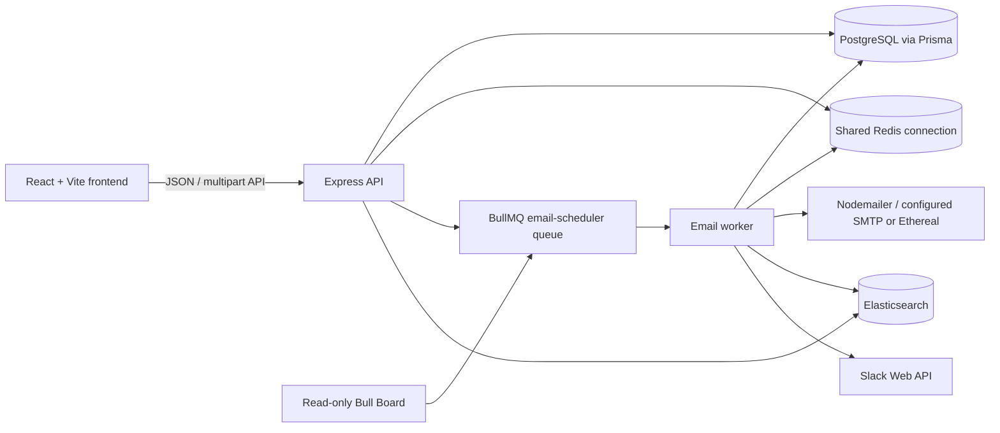

# Architecture

## System overview

The API, worker, queue, and integrations are in the existing backend process. The frontend calls the API; it does not access PostgreSQL, Redis, SMTP, Elasticsearch credentials, or Slack tokens directly.

## Components

| Component | Responsibility |
|---|---|
| React, TypeScript, Vite | Compose UI, scheduled/sent mailbox, details, search, and API requests |
| Express | Health, authentication, email, sender, Slack, and optional Bull Board routes |
| PostgreSQL / Prisma | Users, sender accounts, email jobs, recipients, attachments, events, and Slack connections |
| Redis / ioredis | BullMQ persistence, delayed work, OAuth state, rate reservations/counters, and notification cooldowns |
| BullMQ | Delayed email jobs, retries for delivery errors, and worker coordination |
| Nodemailer | Submits messages and attachments using configured SMTP or generated Ethereal credentials in development |
| Elasticsearch | Full-text email search; PostgreSQL remains authoritative for current records and ownership checks |
| Slack Web API | Optional rate-limit notifications to the configured channel |
| Bull Board | Read-only view of the email queue, protected by Basic Auth |

## Email scheduling lifecycle

1. The frontend posts a `multipart/form-data` request to `POST /api/emails`. It includes the sender ID, recipients, content, scheduled time, optional per-job limits, and any attachments. It sends an `Idempotency-Key` header.
2. The API validates fields and attachment data, resolves the authenticated user, verifies sender ownership, and creates an `EmailJob` and its related records in PostgreSQL.
3. The email job is synchronized to Elasticsearch and enqueued as a BullMQ delayed job. The queue job ID is `email-<EmailJob UUID>`, so scheduling the existing record does not intentionally create another job with a different ID.
4. The worker loads the job from PostgreSQL and checks its status. Cancelled or already sent work is not sent. A job whose scheduled timestamp is still in the future is delayed again until that timestamp.
5. Before SMTP, the worker asks Redis to atomically reserve capacity for the global quota, sender quota, and minimum inter-send delay.
6. If allowed, the worker changes the database status to `PROCESSING`, sends through Nodemailer, commits the Redis reservation only after SMTP accepts the message, then records `SENT` and `sentAt` and syncs Elasticsearch.
7. If rate-limited, the API record remains `SCHEDULED`; its `scheduledAt` and the existing BullMQ job's delayed timestamp are moved to the next allowed time. `RATE_LIMITED` and `RESCHEDULED` events are recorded.
8. SMTP errors use BullMQ's configured retry strategy. A final/non-retryable error records `FAILED`; retryable errors are returned to `SCHEDULED` while BullMQ applies exponential backoff.

## Rate limits and precedence

The limits count email jobs accepted by SMTP, not recipient addresses. A job containing multiple recipients is one send for quota purposes.

| Setting | Scope and precedence |
|---|---|
| `EMAIL_DELAY_MS` | Default minimum gap across all senders. A persisted per-email `minimumDelayMs` takes precedence; the queue payload is a fallback before the environment default. |
| `MAX_EMAILS_PER_HOUR` | Global rolling 60-minute ceiling. It applies to every email and has no per-job override. |
| `MAX_EMAILS_PER_SENDER_PER_HOUR` | Maximum rolling hourly ceiling for each `senderAccountId`. A job's `hourlyLimit` may tighten this value; the effective sender limit is the smaller of the job value and this environment cap. |

Redis uses sorted sets for successful send timestamps and pending reservations, keyed globally and by sender. One Lua script uses Redis server time to remove entries older than 60 minutes, count successful sends and outstanding reservations, check the previous successful send, and reserve available capacity atomically. A second Lua script moves a reservation into successful-send counters after SMTP acceptance; failed sends release it. The shared Redis key hash tag keeps the keys used in one script in the same Redis Cluster slot.

When blocked, the script calculates a retry time based on the oldest successful/reserved quota entry and pending/successful sends for the minimum delay. A minimum 1-second retry floor avoids tight loops. The worker updates the same database job and moves the active BullMQ job into delayed state; it does not create a new `EmailJob` or mark rate-limited work failed. Rate-limit decisions are coordinated across worker instances through Redis, not process-local timers.

Slack notifications are attempted for global and sender quota blocks. Minimum-delay-only blocks do not notify Slack. Redis cooldown keys suppress repeated notifications per user and limit type; a Slack failure is logged and does not fail the email job.

## Idempotency and state

`EmailJob.idempotencyKey` has a PostgreSQL unique constraint. The key is read from `Idempotency-Key` (or the supported body fallback) and is globally unique. Repeating a key for the same user returns the existing non-failed/non-cancelled email job. Reusing another user's key returns a conflict. The handler returns a conflict for a prior failed or cancelled job rather than creating a second row. The request payload is not compared with a previous payload; clients should reuse a key only for the same logical request.

`EmailJob` status is authoritative. Email events record scheduling, processing, send, cancellation, rate-limit, reschedule, and final failure details. Elasticsearch is a search projection and is rechecked against PostgreSQL records after search results are returned.

## Search and indexing

At backend startup, the service ensures the configured `emails` index exists and applies mappings. Create, processing, send, cancellation, retry, and rate-limit rescheduling paths call synchronization. Index synchronization logs failures without changing database status; search itself returns service unavailable when Elasticsearch cannot serve the query. `npm run reindex` rebuilds the index in cursor-paginated batches.

Search combines a full-text Elasticsearch query (subject, sender, recipients, and plain-text body) with user, status, sender, and date filters. It then fetches matching IDs from PostgreSQL with the same user and relevant filters, preserving ownership and current state. Results are paginated. Elasticsearch TLS verification is enabled and trusts the CA loaded from `ELASTICSEARCH_CA_CERT_PATH`; API-key auth takes precedence over username/password auth.

## Attachments

Attachments are accepted as repeated `attachments` form parts on `POST /api/emails`. Multer stores them in `backend/uploads/email-attachments` using random filenames. PostgreSQL records the original safe filename, MIME type, size, and internal storage reference. The reference is stripped from API responses. The worker verifies each stored file still exists and passes its local path to Nodemailer. No attachment list/download endpoint is currently defined.

The backend accepts at most 10 files, 10 MiB per file, and 25 MiB total. Allowed types are PDF, TXT, CSV, PNG, JPG/JPEG, GIF, and WEBP, with extension/MIME and content-signature checks. Upload files and directories use restrictive permissions and are ignored by Git.

## Authentication and security

Protected endpoints use a signed HTTP-only session cookie when available. In `AUTH_MODE=development`, they also accept a valid `x-user-id` UUID. Production mode rejects that development header. Email and sender operations scope queries to the authenticated user; sender ownership is checked before scheduling.

Slack OAuth state is stored in Redis for 10 minutes and consumed atomically. OAuth access tokens are encrypted with AES-256-GCM before storage in `SlackConnection`. The Slack notification channel is selected from `SLACK_NOTIFICATION_CHANNEL_ID`.

Bull Board is mounted at `/admin/queues` only when enabled. It uses Basic Auth, refuses access without configured credentials, hides Redis details, and exposes queue operations in read-only mode. The formatter removes recipients, subject, body, idempotency key, and credentials from displayed job data.

## Persistence and current caveats

PostgreSQL stores application records; Redis stores BullMQ state and rate-limit state. BullMQ retains bounded completion/failure history according to environment-specific age/count settings. A missing Redis connection prevents scheduling/processing; search depends on Elasticsearch. The worker deliberately avoids retrying a message after SMTP acceptance if the subsequent Redis quota commit fails, to avoid duplicate delivery; in that narrow failure window, Redis quota accounting may be incomplete even though the email is marked sent.

There are no Prisma migration files in this checkout. The local setup uses `npx prisma db push` against the schema. Full runtime, external Slack, load, and restart-persistence checks are documented as pending in [TESTING.md](TESTING.md).
